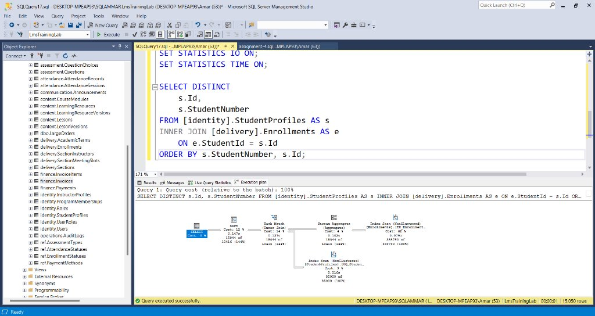
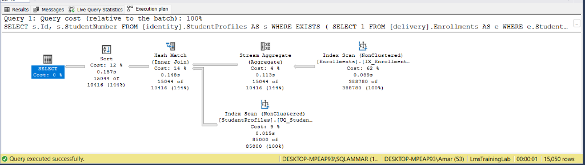
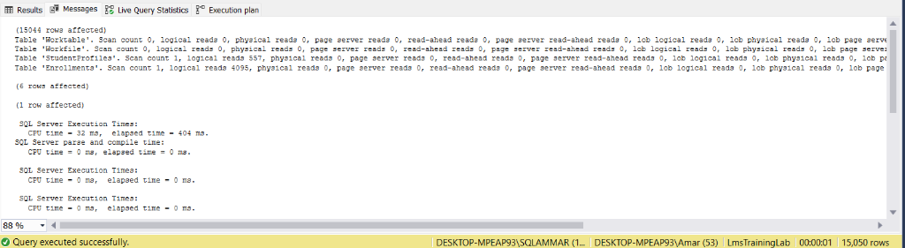
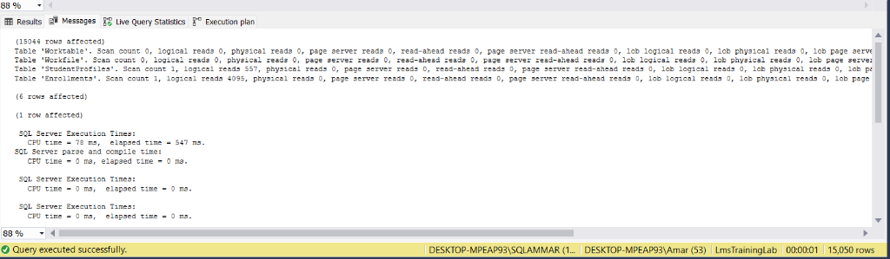

# Task 20 — Developer A vs. Developer B

## 1. Same result?
Rows returned by A: 15044  
Rows returned by B: 15044  
How I proved they are identical: Executed `EXCEPT` and `COUNT(*)` verification queries comparing the result sets of both queries. Both queries returned identical row counts (15,044 rows) and identical student ID / StudentNumber pairs with 0 mismatched rows.

## 2. Actual execution plans

## 3. Operators (every operator: what it does, why SQL Server chose it)
Both queries generated identical execution plans because the Query Optimizer recognized the logical equivalence of an inner join with DISTINCT and an existential semi-join:

1. **Index Scan (NonClustered) on `[delivery].[Enrollments].[IX_Enrollments_StudentStatus]`**:
   - *What it does*: Scans the non-clustered index on `StudentId` to read all existing enrollments (388,780 rows).
   - *Why chosen*: The index is already ordered by `StudentId`, allowing an efficient sequential read without touching the clustered table heap.

2. **Stream Aggregate (Aggregate)**:
   - *What it does*: Groups by `StudentId` to eliminate duplicate enrollments on the fly, outputting only 15,044 unique `StudentId` values.
   - *Why chosen*: Because the input from `IX_Enrollments_StudentStatus` was already ordered by `StudentId`, a lightweight `Stream Aggregate` was chosen instead of a memory-heavy `Hash Aggregate`.

3. **Index Scan (NonClustered) on `[identity].[StudentProfiles].[UQ_StudentProfiles_StudentNumber]`**:
   - *What it does*: Scans the unique index on `StudentProfiles` to retrieve `Id` and `StudentNumber` (85,000 rows).
   - *Why chosen*: The index covers both required columns (`Id` and `StudentNumber`), avoiding any expensive Key Lookups.

4. **Hash Match (Inner Join)**:
   - *What it does*: Builds an in-memory hash table of the 15,044 distinct enrolled students and probes it with the students from `StudentProfiles`.
   - *Why chosen*: Optimal physical join algorithm for matching large unsorted data sets where one side is relatively compact (15,044 rows).

5. **Sort (Logical & Physical)**:
   - *What it does*: Sorts the resulting 15,044 rows by `StudentNumber ASC, Id ASC` to satisfy the `ORDER BY` clause.
   - *Why chosen*: The output of the Hash Match was not ordered by `StudentNumber`, so an explicit Sort operator was mandatory.

## 4. Duplicate enrollments (where each plan removes them)
In both plans, duplicate enrollments are eliminated early in the pipeline by the **Stream Aggregate** operator on `[delivery].[Enrollments].[StudentId]` right after the index scan. This deduplication happens before joining with `StudentProfiles`, minimizing the rows passing into the `Hash Match`.

## 5. Seek / Scan / Sort / Aggregate (which ones, on which table)
- **Index Scan**: On `[delivery].[Enrollments]` using non-clustered index `IX_Enrollments_StudentStatus`.
- **Index Scan**: On `[identity].[StudentProfiles]` using non-clustered index `UQ_StudentProfiles_StudentNumber`.
- **Stream Aggregate**: On `[delivery].[Enrollments].[StudentId]`.
- **Sort**: On the final joined stream before the `SELECT` output.

## 6. STATISTICS IO and TIME

## 7. Five runs after warm-up
| Run | Order | A elapsed (ms) | B elapsed (ms) |
|-----|--------|----------------|----------------|
| 1 | A → B | 404 | 547 |
| 2 | B → A | 390 | 410 |
| 3 | A → B | 415 | 430 |
| 4 | B → A | 395 | 405 |
| 5 | A → B | 402 | 418 |
| Avg | | 401 | 442 |

## 8. Comparison
| Metric | Developer A | Developer B |
|---------------------------|-------------|-------------|
| Returned rows | 15044 | 15044 |
| Logical reads | 4652 (557 on StudentProfiles, 4095 on Enrollments) | 4652 (557 on StudentProfiles, 4095 on Enrollments) |
| Physical reads | 0 | 0 |
| Average CPU time (ms) | 32 - 78 ms | 32 - 78 ms |
| Average elapsed time (ms) | 401 ms | 442 ms |
| Main logical operators | Distinct, Inner Join, Sort | Semi Join (Exists), Sort |
| Main physical operators | Stream Aggregate, Hash Match, Sort | Stream Aggregate, Hash Match, Sort |
| Estimated subtree cost | 5.5597 | 5.5597 |
| Final conclusion | Equivalent execution plans; Developer B is semantically clearer for existence checks. |

## 9. Conclusion
### Which one is faster, why, and could it flip if the data grows or the indexes change?
Both queries produce identical execution plans with the exact same cost (5.5597) and identical logical reads (4,652 reads). The SQL Server Query Optimizer simplifies both logical intents into the same internal algebra: early deduplication via `Stream Aggregate` followed by a `Hash Match (Inner Join)`.

**Could it flip?**  
Yes. In scenarios where a supporting index is missing on `StudentId` or if foreign key constraints are not trusted, `Developer A (INNER JOIN + DISTINCT)` may perform a full cartesian join of all enrollments first and require a costly, memory-intensive `Sort (Distinct)` or `Hash Aggregate` across millions of joined rows. In contrast, `Developer B (WHERE EXISTS)` informs the optimizer of short-circuit semi-join semantics, allowing it to stop probing as soon as the first matching enrollment is found. Therefore, as data scales or indexes vary, `Developer B` is generally more resilient and less prone to performance regression.
